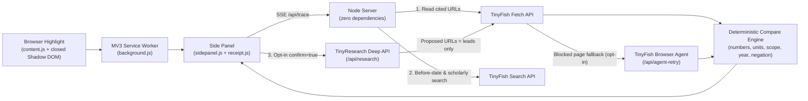

# Source Hunter

> **Judge 30-Second Quick Start:** View the live gallery at [https://cursedruntime404.github.io/source-hunter/demo/](https://cursedruntime404.github.io/source-hunter/demo/) (works instantly in any browser with no installation) or open [demo/index.html](demo/index.html) locally if you cloned the repository. For a complete testing guide, see the [Judge Quickstart Guide](submission/judge-quickstart.md).

Highlight any number, claim, or quote on the web. One click (**Trace source**, right-click menu, or `Alt+Shift+T`) traces it back through cited sources, verifies every quote verbatim from fetched pages, and shows where the claim originated — or says honestly when no source can be found.

---

## What This Does NOT Do (4 Honest Limits)

1. **Does not bypass bot checks, paywalls, or logins:** Pages behind bot checks, paywalls, or logins cannot be read. Unreadable pages are listed transparently under *rejected pages*, and if the earliest accessible page is an institutional press release, it is labeled as an institutional press release, not a primary study.
2. **Does not hallucinate or guess sources:** If inline citations stop and web searches find no matching quotes, Source Hunter halts with `NO_SOURCE` or `UNCITED`. It never invents citations, quotes, dates, or authors with an LLM.
3. **Does not run unmonitored live browser automation:** The Browser Agent is an opt-in fallback (`ALLOW_AGENT=1`) with strict daily limits. Only the `example.com` structured test passed; the one real blocked-page attempt on `psychology.stackexchange.com` timed out ($0.160 USD) and is not marked passing on a real trace.
4. **Does not call live APIs without daily spend caps:** To prevent unexpected charges, `TF_MODE` defaults to `record` (enforcing strict daily caps in `server/.tfcache/usage.json` for live calls; cache hits are free) or `replay` (zero network calls). TinyResearch runs require explicit confirmation (`ALLOW_RESEARCH=1`, `confirm: true`).

---

## 5-Minute Quick Setup

### 1. Start the local server (Node 20+, zero dependencies)
```bash
cd server
copy .env.example .env      # or cp .env.example .env on macOS/Linux
```
- **With `TINYFISH_API_KEY` in `server/.env` (Default: `record`):** `TF_MODE` defaults automatically to `record` — cache hits in `server/.tfcache/` cost `$0.000`, and cache misses call live TinyFish APIs (enforcing daily hard caps in `server/.tfcache/usage.json`) and save responses for future replay.
- **Offline Replay Demo / No API Key (`replay`):** Leave `TINYFISH_API_KEY` unset (or set `TF_MODE=replay`) to replay recorded gallery traces strictly from `server/.tfcache/` with zero network calls.

```bash
cd server
npm test     # 43 offline unit & regression tests (zero network calls)
npm start    # starts http://localhost:8787
```

### 2. Load the Chrome Extension (Manifest V3)
1. Open `chrome://extensions` and turn on **Developer mode**.
2. Click **Load unpacked** and select the [extension/](extension/) folder.
3. Highlight any claim on a page and click **Trace source** (or press `Alt+Shift+T` / right-click **Trace this claim with Source Hunter**).

*(Chrome users can check or change the keyboard shortcut anytime at `chrome://extensions/shortcuts`.)*

---

## Architecture



---

## How TinyFish is used

| Endpoint | Usage & Role in Source Hunter | Verification & Guardrails |
| --- | --- | --- |
| **Fetch** (`api.fetch.tinyfish.ai`) | **Used on every trace.** Reads highlighted pages, footnote targets, cited URLs (up to 6 hops live / 3 dev), and Search candidates | Claim text must appear on the page; quoted sentences are extracted verbatim substrings |
| **Search** (`api.search.tinyfish.ai`) | **Used on every trace.** Finds earlier primary reports/studies omitted by inline links (`before_date` + scholarly queries) | Results must be fetched & verified verbatim before becoming a hop; irrelevant pages listed under *rejected* |
| **Browser Agent** (`agent.tinyfish.ai/v1/automation/run`) | **Opt-in; structured test passed; one real blocked-page attempt timed out; not demonstrated on a real trace.** Opt-in retry (`POST /api/agent-retry`) for Fetch-blocked URLs (`ALLOW_AGENT=1`) | Tagged weaker evidence; only the `example.com` structured test passed; the one real blocked-page attempt on `psychology.stackexchange.com` timed out (`$0.160 USD`) and is not marked passing on a real trace |
| **TinyResearch** (`run-research-async`) | **One opt-in deep run, saved result.** Opt-in background deep trace (`POST /api/research`, `confirm: true`, `ALLOW_RESEARCH=1`) | Every URL cited in Deep Research is treated as an **unverified lead** until re-fetched verbatim by Fetch. One deep run on the plastic claim; it did not reach the Science paper; its citations were re-verified by Fetch (5 confirmed, 7 discarded) |

---

## Measured Performance & Speed

Execution times are based on actual recorded run timings on disk:
- **Offline Cache Replay (`TF_MODE=replay`):** **26ms to 640ms** across all 9 recorded traces (sub-second local cache read and DOM rendering).
- **Live Multi-Hop Trace (`TF_MODE=record`):** **10s to 40s** for multi-step network fetching, link extraction, and before-date search queries.
- **Deep Research Run (`TinyResearch`):** **282s** (~4.7 minutes) for comprehensive multi-source investigative research.

---

## Built-in Honesty & Credit Safety

- **No invented evidence:** No quote, URL, or date is generated by an LLM. Every verdict flag (`MATCH`, `ROUNDED`, `YEAR`, `SCOPE`, `HEDGE_DROPPED`, `CAUSATION`, `MISQUOTED`, `CONTRADICTED`, `DISPUTED`, `UNCITED`, `NO_SOURCE`) is computed deterministically in `server/src/compare.js` and `server/src/text.js`.
- **Secondary origins are never called "original":** When the earliest page found states the claim without citing a source, Source Hunter assigns an amber **`UNCITED`** badge (*"Earliest page found cites no source; original not found"*). When an earliest verified page is a university/agency newsroom release under `/news` or `/press`, it is labeled *"institutional press release about the study"* rather than *"likely primary source"*.
- **Date uncertainty:** Pages marked `"updated"` or carrying dates mismatched with URL slugs or era (e.g. a 2026 blog repeating a 1943 quote) show **`date uncertain`**.
- **Myths & disputes:** Context windows and titles are scanned for debunking cues referencing the claimed statement itself (`"slowing down"` or mismatched attribution numbers do not count); disputed claims show the verbatim disputing sentence and a **`Disputed`** Drift Meter state.
- **Credit-safety defaults:** `TF_MODE` defaults to `record` when `TINYFISH_API_KEY` is present (cache hits free, misses call live within caps) and `replay` when unkeyed or for the gallery demo; `server/.tfcache/usage.json` enforces daily hard caps (`MAX_FETCH_URLS_PER_DAY=150`, `MAX_SEARCHES_PER_DAY=40`, `MAX_AGENT_CALLS_PER_DAY=3`, `MAX_RESEARCH_RUNS_PER_DAY=0`). Balance changes are logged in [demo/spend-log.md](demo/spend-log.md).
- **Debug Transparency:** Click **Copy debug report** in the side panel footer to copy the sanitized trace JSON (timings, usage counters, verbatim hops, rejected URLs) with zero API keys or headers.
